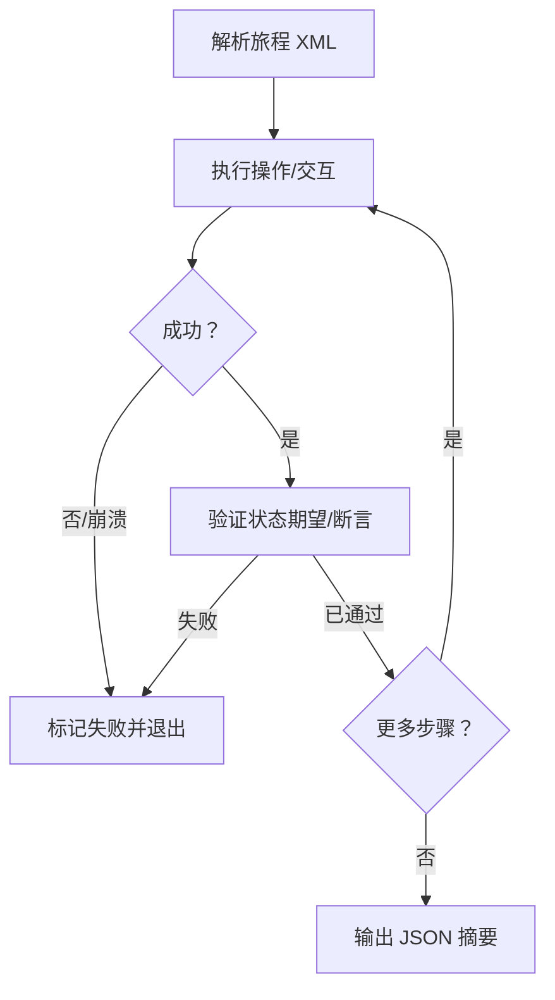

# Android UI 旅程测试

## 概述

本技能概述了在 Android 应用程序上运行 XML 指定用户旅程测试的标准工作流程。"旅程"是一组有序的用户操作和状态断言，旨在验证端到端功能。旅程 XML 充当应用程序行为的事实来源。执行器按顺序进行，执行 UI 交互、检查状态断言并编写标准化的 JSON 结果报告。

## 何时使用

- 针对 XML 测试规范评估 Android 应用程序的 UI 行为时使用。
- 自动化多步用户流程（如登录、结账、导航）并验证期望时使用。
- 运行验证测试并生成标准化 JSON 测试报告时使用。
- 使用 ADB 命令在物理设备或模拟器上调试应用程序流程时使用。

## 工作原理



### 步骤 1：解析旅程规范

读取和解析 XML 测试套件结构。根节点 `<journey>` 定义测试用例名称，`<actions>` 块包含测试步骤序列。

```xml
<journey name="搜索和购物车流程">
   <description>验证搜索项目并将其添加到购物车的操作成功。</description>
   <actions>
      <action>搜索汽水</action>
      <action>点击第一个搜索结果</action>
      <action>验证产品详情屏幕已显示</action>
   </actions>
</journey>
```

### 步骤 2：顺序步骤评估

按指定的确切顺序处理每个 `<action>` 元素。测试步骤分为两组：

#### A. 交互操作（点击、滑动、文本输入）

使用 ADB 执行物理 UI 交互。
- **点击**：点击目标元素边界的中心：
  ```bash
  adb shell input tap <x> <y>
  ```
- **滑动/滚动**：从坐标滑动到坐标，持续时间为：
  ```bash
  adb shell input swipe <x1> <y1> <x2> <y2> <duration_ms>
  ```
- **文本输入**：在活动输入字段中输入文本：
  ```bash
  adb shell input text "<string>"
  ```
如果元素缺失或无法执行该操作，操作和旅程将失败。

#### B. 状态断言（期望验证）

以"验证"、"检查"或"确保"开头的步骤表示状态断言。
- 检查当前屏幕（使用截图或 `uiautomator dump`），而不进行交互或滚动。
- 确认所有子断言都得到满足。例如，*"验证应用程序在主屏幕上，且徽标可见"* 如果未显示主屏幕 **或** 徽标缺失，则失败。

### 步骤 3：处理失败和崩溃

如果应用程序崩溃、退出、冻结或断言失败：
1. 立即停止旅程执行。
2. 将失败的步骤标记为 `FAILED`。
3. 将任何后续步骤标记为 `SKIPPED`。
4. 记录失败的确切原因。

### 步骤 4：生成 JSON 报告

将执行结果格式化为标准化的 JSON 架构，并将其写入输出日志。

---

## 示例

### 示例 1：完整旅程 XML 规范

```xml
<journey name="登录和个人资料编辑">
   <description>登录到应用程序，导航到设置，并更改用户个人资料信息。</description>
   <actions>
      <action>验证用户名输入字段可见</action>
      <action>点击用户名输入字段</action>
      <action>在输入框中输入"testuser"</action>
      <action>点击密码输入字段</action>
      <action>在输入框中输入一个已编辑的测试密码</action>
      <action>点击"登录"按钮</action>
      <action>验证主页仪表板可见且用户个人资料照片已显示</action>
   </actions>
</journey>
```

### 示例 2：标准 JSON 结果报告

```json
{
  "journey": "登录和个人资料编辑",
  "results": [
    {
      "action": "验证用户名输入字段可见",
      "status": "PASSED",
      "commands": [],
      "comment": "用户名输入在边界 [100,200][980,300] 处通过 UI dump 检测到。"
    },
    {
      "action": "点击用户名输入字段",
      "status": "PASSED",
      "commands": [
        "adb shell input tap 540 250"
      ],
      "comment": "点击了用户名输入的中心坐标。"
    },
    {
      "action": "在输入框中输入\"testuser\"",
      "status": "PASSED",
      "commands": [
        "adb shell input text \"testuser\""
      ],
      "comment": "用户名输入成功。"
    },
    {
      "action": "点击密码输入字段",
      "status": "PASSED",
      "commands": [
        "adb shell input tap 540 370"
      ],
      "comment": "点击了密码输入的中心。"
    },
    {
      "action": "在输入框中输入一个已编辑的测试密码",
      "status": "PASSED",
      "commands": [
        "adb shell input text \"[REDACTED_PASSWORD]\""
      ],
      "comment": "密码输入成功。实际输入值未存储在报告中。"
    },
    {
      "action": "点击\"登录\"按钮",
      "status": "PASSED",
      "commands": [
        "adb shell input tap 540 500"
      ],
      "comment": "登录按钮已点击。"
    },
    {
      "action": "验证主页仪表板可见且用户个人资料照片已显示",
      "status": "FAILED",
      "commands": [],
      "comment": "仪表板已加载，但 UI 标头中缺少个人资料照片。"
    }
  ]
}
```

---

## 最佳实践

- ✅ **计算点击中心**：解析元素边界（如 `[x1,y1][x2,y2]`）时，始终计算中间坐标：
  $$x_{center} = \frac{x_1 + x_2}{2}, \quad y_{center} = \frac{y_1 + y_2}{2}$$
- ✅ **包括睡眠缓冲区**：在交互操作（如按钮点击）之后始终添加短延迟（例如 1-2 秒），以允许布局和转换在执行断言之前渲染。
- ✅ **快速失败**：遇到第一个失败时立即停止测试。在失败后继续会导致无效结果。
- ✅ **安全地记录精确命令**：在 JSON 输出列表中包括非敏感原始命令（如 `adb shell input tap`）用于诊断。对进入密码、OTP、令牌、支付或个人数据字段的文本进行编辑；永远不要在报告、CI 日志或共享工件中保留字面密钥。

## 限制

- 解析器仅评估静态屏幕层次结构（例如 `uiautomator dump`）。需要滚动的元素将标记为不可见，除非明确执行滚动操作。
- 非标准 UI 组件（如自定义 OpenGL 画布视图）无法通过标准辅助功能树读取，可能需要截图分析或硬编码点击地图。
- 通过 ADB 的关键事件和文本输入不会在所有模拟器镜像上触发标准软键盘事件，这可能导致输入验证问题。

## 相关技能

- `@android-cli` - 一般 CLI 工具语法、包安装和设备查询。
- `@android_ui_verification` - 常规 UI 检查的直接 ADB 脚本模板。
