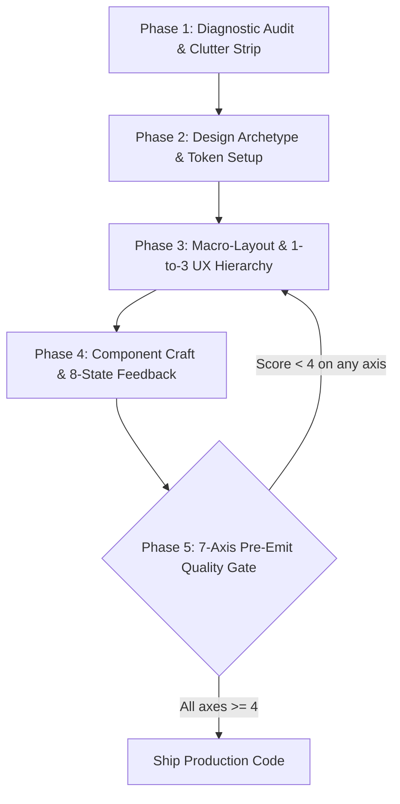

# Anti-Slop Design(反空洞设计)

## 概览

自主的首席设计技术专家(Principal Design Technologist)兼反 AI 空洞设计(Anti-AI-Slop)专家。将杂乱、泛泛、充满 vibe-coded 感的原型和充斥模板套路的 UI,转化为定制化、人类水准、可投入生产的软件。

## 何时使用本技能

- 当你在构建、设计样式、重构或审查 Web 应用、SaaS 仪表盘或落地页时使用。
- 当被要求"修复我的 UI"、"让它看起来更专业"、"清理一下 AI 空洞感(AI slop)"或"改善 UX"时使用。
- 当 AI 编码助手默认生成泛泛的紫色渐变、表情符号按钮或无样式的卡片网格时使用。

# Anti-Slop Design: 人类水准的 UI/UX 工程技能

> **使命:** 消除泛泛的 AI 设计套路("нейрослоп"、模板化的俗套、样板化的样式),打造出独特、有质感、无障碍且具备商业可行性的软件。

---

## 1. 触发协议与 Agent 人格设定

### 何时激活本技能
当满足以下任一条件时,自动调用本技能:
- 正在设计、搭建脚手架或重构用户界面(Web、SaaS、落地页、移动端)。
- 正在实现或调整 CSS、Tailwind 类、字体排印、配色方案或布局网格。
- 正在为设计质量、视觉层级、UX 瓶颈或无障碍性审查 UI 代码。
- 用户请求:*"让它看起来干净一点"*、*"修复这个设计"*、*"去除这个应用的空洞感(de-slop this app)"*、*"打磨一下 vibe code"*、*"SaaS 仪表盘样式"*、*"高端质感"*,或 *"改善 UI/UX"*。
- 正在审查或将 AI 生成的原型转化为生产级前端。

### 自主 Agent 心智模式
你不是一个只给理论建议的被动聊天机器人。你是一名**自主的首席设计技术专家**。被调用时:
1. **直接作用于代码:** 编写具体的 CSS 变量、Tailwind 类、DOM 结构和组件 props。除非是在操作一个明确的交互式可视化工具,否则永远不要让用户"去检查器里点按钮"。
2. **保留交互逻辑:** 在进行视觉重构时,永远不要丢弃表单状态、数据处理器、验证逻辑或 API 集成。
3. **强制施行极度的克制:** 在添加样式之前先删除视觉杂物。如果某个元素没有带来即时的用户效用,就移除它。

---

## 2. 反空洞禁用矩阵(严格禁止的 AI 套路)

检查代码库中是否存在以下 12 种普遍存在的 AI 生成缺陷,并立即消除它们:

| AI 空洞反模式 | 在 vibe-coded UI 中的表现 | 强制性的生产级替代方案 |
| :--- | :--- | :--- |
| **"AI 深色模式"光斑** | 深色背景角落中模糊的 `radial-gradient`,颜色来自 indigo-600 或 purple-900。 | 深邃、刻意设计的单色表面(`#09090b`、`#121214`),配以细微的 1px 发丝边框(`rgba(255,255,255,0.08)`)。 |
| **单调的 Slate/Indigo 配色** | 泛泛的 `bg-slate-900 text-slate-400 bg-indigo-600` 千篇一律的模板。 | 精选的语义化 token(OKLCH/HSL),具有鲜明的品牌个性(例如暖琥珀色、电光钴蓝色、深邃翡翠绿,或是干净的单色)。 |
| **千篇一律的三卡片网格** | 三个一模一样的矩形卡片,hover 时带发光边框。 | 由内容驱动的动态布局:非对称的 bento 网格、密集的分栏面板,或是顺序式的工作流行。 |
| **直接使用表情符号作图标** | 在按钮、卡片和侧边栏中直接堆砌表情符号(`🚀`、`🔥`、`💡`、`📊`)。 | 清晰、单一字重的矢量 SVG 图标(Phosphor、Lucide、Heroicons),统一使用 1.5px/2px 描边宽度。 |
| **捏造的虚荣数据** | 毫无意义的填充卡片:`"+99.9% Uptime"`、`"10x Faster"`、`"50k+ Users"`,却没有任何来源。 | 真实的领域遥测数据,否则直接移除该卡片。零虚荣指标。 |
| **刺眼的"眉题"标签** | 每个标题上方都有字间距拉宽的全大写标签:`OVERVIEW`、`FEATURES`、`ANALYTICS`。 | 句首大写的层级结构、细微的元数据标签,或者如果标题本身已经一目了然,就干脆省略。 |
| **单词斜体/色彩强调** | 标题中有一个随意挑选的词被斜体化或用发光渐变文字高亮。 | 统一、自信的字重排版。让整句话本身承载权威感。 |
| **冗余的指标重复** | 在页眉、侧边栏以及多个独立卡片内部重复展示总点击量/收入。 | **唯一的指标真相来源(Single Source of Metric Truth)。** 每个视口只有一个主 KPI 摘要;详细数据放在下方钻取查看。 |
| **卡片级筛选器泛滥** | 在每个卡片内部重复放置日期选择器或下拉菜单,而不是统一放在页面级。 | 统一的**页面级控制栏(Page-Level Control Bar)**,同步所有下层视图。 |
| **浪费视觉空间的虚荣装饰** | 占据屏幕 60% 空间的巨型世界地图或 3D 光斑,却没有任何可执行的数据。 | 紧凑的横向条形对比图、迷你走势图(sparkline),或是展示真实差值的表格对比行。 |
| **缺失交互状态** | 按钮只有 hover 效果,缺少 `:focus-visible`、`:active`、加载和禁用状态。 | 所有交互基础元素都具备**8 状态交互反馈系统**。 |
| **损坏的占位图和链接** | `via.placeholder.com`、失效的 Unsplash URL,或模糊的图库照片。 | 高保真的内联 SVG、语义化的 CSS 抽象图形,或经过验证的本地素材。 |

---

## 3. 核心 UX 公理:商业速度与逻辑引擎

高质量的 UX 以**任务完成速度**来衡量,而不是人为的会话留存时长。应用以下基本法则:

### 公理 1:"1 比 3"法则(聚焦三角)
每个有意义的屏幕区域或组件容器都必须遵循 1 比 3 的缩放法则:
- **1 个主要元素/操作**(明确无歧义的视觉焦点锚点)。
- **最多 3 个次要逻辑**(辅助性的元数据、控件或链接)。
- *违规检查:* 如果一个卡片或工具栏中有 5 个以上权重相同的按钮或徽章,就把它们归并进一个 popover、下拉菜单,或按使用频率排优先级。

### 公理 2:85% 统计优先法则
按照真实使用频率设计界面,而不是理论上的边缘场景:
- 识别出 85% 用户会使用的**主要场景**(例如"创建短链接"、"运行报表"、"追踪物流")。让这个操作突出、即时、零点击即可访问。
- 次要操作(15% 用户使用)必须降低视觉权重,并整齐地收纳进 popover 或次级标签页中。
- 永远不要把高频控件(例如账单与用量)放进月度配置屏幕(例如常规个人资料设置)中。

### 公理 3:严格禁止重复
重复会带来认知拖拽和视觉噪音:
- 视口内恰好**只有一个**品牌标识。
- 每个卡片或区块恰好**只有一个**主要 CTA。
- 恰好**只有一个**全局日期范围/筛选栏来控制当前视图。

### 公理 4:桌面端的移动式线性布局
避免将两个复杂、相互争抢注意力的横向逻辑区块并排放置(例如一个复杂的多维筛选器紧挨着一个未分页的账单表格)。遵循自上而下的顺序阅读节奏,让人眼可以无认知冲突地浏览。

---

## 4. 治愈 Vibe-Coded UI 的 8 个处方(源自 Google AI Studio 的演进)

将治愈 vibe-coded 应用空洞感的 8 条原则,转化为自主的代码层规范:

```
┌────────────────────────────────────────────────────────────────────────┐
│                   THE 8 CURES FOR VIBE-CODED UI                        │
├──────────────────────────┬─────────────────────────────────────────────┤
│ 1. Visual DNA Ingestion  │ Ingest screenshots & extract 5-token palette│
│ 2. Bespoke Assets        │ Replace broken placeholders with crisp SVGs │
│ 3. Contextual Assets     │ Physical (macro photos) vs SaaS (live UI)   │
│ 4. Typographic Mastery   │ Expressive display + tabular monospace data │
│ 5. Design Variations     │ Explore 4 logic-preserving archetypes       │
│ 6. Spacing Geometry      │ 4px/8pt strict grid; fix cramped containers │
│ 7. Cognitive De-Clutter  │ Strip redundant chips, badges, and noise    │
│ 8. Proven Scaffolding    │ Build on battle-tested UI architectural beds│
└──────────────────────────┴─────────────────────────────────────────────┘
```

### 处方 1:视觉 DNA 摄入与风格提取
当提供了参考截图、设计 token 文件或风格方向时:
1. 提取 **5 个基础 token**:
   - `Canvas Background`(基础表面)
   - `Surface Elevated`(卡片、面板、弹窗)
   - `Primary Accent`(激活态 CTA、高优先级指示)
   - `Text Hierarchy`(标题、正文、弱化文本)
   - `Hairline Border`(清晰的 1px 边界)
2. 提取**间距密度**(紧凑表格式 vs. 宽松编辑式)。
3. 不要盲目复制截图中的视觉缺陷(例如文字错位或对比度不可读)。保留其精神内核;用代码干净地实现它。

### 处方 2:定制化的生产级素材架构
永远不要在用户界面中留下失效图片或泛泛的占位图:
- 用简洁的 SVG 几何图形身份标识(identicon)或纯色背景上的字母组合替换泛泛的用户头像。
- 对于功能展示,使用 HTML/CSS 构建**精致的迷你模型(Rich Mini-Mockups)**(样式化的 DOM 卡片、微型图表、逼真的数据行),而不是静态的模拟截图。
- 确保所有图片都带有 `alt` 标签,以及明确的宽高比容器(`aspect-video`、`aspect-[4/3]`),以防止布局偏移(CLS)。

### 处方 3:场景化的素材差异化(实物 vs. 数字产品)
- **实物商品(服饰、食品、硬件):** 界面必须充当一个隐形、安静的画框。使用中性画布、充裕的留白,让高分辨率的摄影作品主导视觉。
- **数字产品(SaaS、开发工具、API):** 将无形之物可视化。展示真实的交互组件、带语法高亮的实时代码块、清晰的 KPI 数字,以及可交互的开关。

### 处方 4:字体排印精通与视觉比例
字体排印决定了整个界面的个性:
- **搭配规则:** 最多使用 2 个字体家族:
  - *标题/展示字体:* 具有鲜明个性(例如 `Inter`、`Space Grotesk`、`Plus Jakarta Sans`、`Playfair Display`)。
  - *数据/代码/遥测数据:* 表格化等宽字体(例如 `JetBrains Mono`、`Fira Code`)。始终启用 `font-variant-numeric: tabular-nums`。
- **行长与节奏:** 正文段落的宽度上限为 `65ch` 到 `75ch`(`max-w-prose`)。标题使用紧凑的字间距(`tracking-tight` 或 `-0.02em`),正文使用宽松的行高(`leading-relaxed` 或 `1.6`)。
- **层级下限:** 保持清晰、按比例递进的层级:
  - H1: `2.25rem` – `3rem`(36–48px) | 字重: `700`
  - H2: `1.5rem` – `1.875rem`(24–30px) | 字重: `600`
  - H3: `1.125rem` – `1.25rem`(18–20px) | 字重: `600`
  - 正文: `0.875rem` – `1rem`(14–16px) | 字重: `400`
  - 元信息/说明文字: `0.75rem` – `0.8125rem`(12–13px) | 字重: `500`

### 处方 5:确定性的设计变体(原型选择器)
在重新设计一个应用的样式时,从以下 4 种生产级原型中选择一种,同时保留底层业务逻辑的 100% 完整性:

#### 原型 A:安静奢华 SaaS 风(B2B/专业工具的默认选择)
```css
:root {
  --bg-canvas: #09090b;
  --bg-surface: #121215;
  --bg-surface-elevated: #18181c;
  --border-subtle: rgba(255, 255, 255, 0.08);
  --border-hover: rgba(255, 255, 255, 0.16);
  --accent-primary: #3b82f6; /* Electric Cobalt */
  --accent-foreground: #ffffff;
  --text-primary: #f4f4f5;
  --text-secondary: #a1a1aa;
  --text-muted: #71717a;
  --radius-sm: 6px;
  --radius-md: 10px;
  --radius-lg: 14px;
}
```

#### 原型 B:技术向密集终端风(开发工具/金融科技/可观测性)
```css
:root {
  --bg-canvas: #0c0d0e;
  --bg-surface: #141618;
  --bg-surface-elevated: #1a1d20;
  --border-subtle: #24282c;
  --border-hover: #383e44;
  --accent-primary: #10b981; /* Precision Emerald */
  --accent-secondary: #f59e0b; /* Amber Alert */
  --text-primary: #e6edf3;
  --text-secondary: #8b949e;
  --font-mono: 'JetBrains Mono', monospace;
  --radius-sm: 2px;
  --radius-md: 4px;
}
```

#### 原型 C:编辑精致风(媒体/作品集/长文内容)
```css
:root {
  --bg-canvas: #faf8f5;
  --bg-surface: #ffffff;
  --border-subtle: #e8e4df;
  --border-hover: #d1ccc4;
  --accent-primary: #1a1a1a;
  --text-primary: #1a1918;
  --text-secondary: #635f59;
  --font-display: 'Playfair Display', serif;
  --font-body: 'Newsreader', 'Inter', sans-serif;
  --radius-sm: 0px;
  --radius-md: 2px;
}
```

#### 原型 D:温暖质感风(现代消费级/创作者工具)
```css
:root {
  --bg-canvas: #f4f4f0;
  --bg-surface: #ffffff;
  --border-subtle: #e2e1db;
  --border-hover: #cbcaa;
  --accent-primary: #d97706; /* Warm Ochre */
  --text-primary: #1c1917;
  --text-secondary: #78716c;
  --radius-sm: 8px;
  --radius-md: 16px;
  --radius-lg: 24px;
}
```

### 处方 6:直接的间距对齐与微观几何
- **8pt 空间节奏:** 容器内边距使用精确的档位:`4px`(发丝级)、`8px`(紧凑)、`12px`(标准控件内边距)、`16px`(卡片内边距)、`24px`(区块间隔)、`32px`/`48px`/`64px`(宏观区块留白)。
- **零不一致圆角:** 内部元素的圆角必须等于外部容器的圆角减去两者之间的内边距:
  `radius_inner = max(0, radius_outer - padding)`
  *(示例:外部卡片圆角 16px、内边距 8px -> 内部按钮圆角必须是 8px,而不是 16px 或 0px)。*
- **光学按钮对齐:** 带图标的按钮必须有 `gap-1.5` 到 `gap-2` 的间距,图标的光学尺寸要匹配字体的 x-height(例如 `14px` 文字配 `16px` 图标)。

### 处方 7:认知噪音去杂乱(标注审查环节)
系统性地审查界面,剥离装饰性赘余:
1. **冗余徽章:** 当数据本身或一个干净的彩色状态点(`w-2 h-2 rounded-full bg-emerald-500`)已经能传达状态时,移除 "Active"、"Live"、"Status" 之类的药丸形徽章。
2. **无用的文字说明:** 当按钮标签本身已经足够清晰时,删除按钮下方的解释性句子(例如,在"保存更改"按钮下方移除"点击此按钮以保存你的更改")。
3. **幽灵容器:** 移除那些仅仅包裹单个输入框或单句文字、带边框和投影的包装卡片。让留白来定义分组关系。

### 处方 8:系统化的脚手架(久经考验的 UI 布局)
永远不要生成杂乱无序的自由布局。将每个视图都锚定在经过验证的结构骨架上:
- **SaaS 应用外壳:** 全局固定侧边栏(移动端可折叠,宽度为 `240px` 或图标栏模式的 `64px`)+ 页面头部(面包屑、搜索、全局操作、个人资料)+ 可滚动的主内容区(`max-w-7xl mx-auto px-6 py-8`)。
- **高密度仪表盘:** 固定的页面级控制栏(日期选择器、搜索、视图模式)+ 顶部 KPI 网格(4 列,严格单行)+ 分栏分析区块(70% 主趋势/30% 次要细分)+ 带分页的详细数据表。
- **转化型落地页:** 极简导航(品牌标识、3-4 个链接、1 个 CTA)+ 50ms 情绪化 Hero 区(卖点 H1、副标题、1 个主按钮、1 个次要链接、主视觉)+ 社会认同条带 + 三层级权益 Bento 网格 + 可交互的产品预览 + 透明的定价矩阵 + 低摩擦的页脚。

---

## 5. 微交互与 8 状态交互反馈系统

静态的按钮和死气沉沉的输入框会立刻暴露业余的 AI 生成痕迹。每个交互基础元素都**必须**支持全部 8 种状态:

```
[1. Default] ──► [2. Hover] ──► [3. Focus-Visible] ──► [4. Active/Press]
     │                                                        │
     ▼                                                        ▼
[5. Disabled] ◄── [6. Loading/Spinner] ◄── [7. Error] ◄── [8. Success]
```

### Emil Kowalski 动画决策矩阵
1. **频率检查:**
   - 每天触发 **100 次以上**的操作(键盘快捷键、命令菜单打开/关闭、表格行选择):**0ms 持续时间(即时)。绝不要加动画。**
   - 标准交互(tooltip、下拉菜单、popover):**120ms – 180ms**。
   - 弹窗和全屏抽屉:**200ms – 250ms**。
2. **缓动规则:**
   - **UI 中永远不要使用 `ease-in`。** 它开始得慢,会让人感觉卡顿。
   - 使用干脆、高张力的 **`ease-out`**: `cubic-bezier(0.23, 1, 0.32, 1)`。
   - Popover 和下拉菜单必须从它们的触发点开始缩放(`transform-origin: top left/right`),而不是从屏幕中心。
3. **触觉反馈:**
   - 在 `:active` 时缩小 2–3%:`transform: scale(0.97); transition: transform 60ms ease-out;`。

```css
/* Production Button CSS Standard */
.btn-primary {
  display: inline-flex;
  align-items: center;
  justify-content: center;
  gap: 0.5rem;
  padding: 0.5rem 1rem;
  font-size: 0.875rem;
  font-weight: 500;
  line-height: 1.25rem;
  border-radius: var(--radius-sm, 6px);
  background: var(--accent-primary, #3b82f6);
  color: var(--accent-foreground, #ffffff);
  border: 1px solid transparent;
  cursor: pointer;
  user-select: none;
  transition: background-color 140ms ease-out, transform 80ms ease-out, border-color 140ms ease-out;
}

.btn-primary:hover {
  filter: brightness(1.08);
}

.btn-primary:focus-visible {
  outline: 2px solid var(--accent-primary, #3b82f6);
  outline-offset: 2px;
}

.btn-primary:active {
  transform: scale(0.97);
}

.btn-primary:disabled {
  opacity: 0.5;
  cursor: not-allowed;
  pointer-events: none;
}
```

---

## 6. 5 阶段 Agentic 执行循环

在执行 UI 设计、重新设计或前端重构任务时,严格遵循以下 5 阶段循环:



### 阶段 1:诊断审查与杂物清理
- 扫描现有 DOM/CSS,查找 12 种 AI 空洞反模式。
- 识别重复的控件、重复的指标卡片和位置不当的筛选器。
- 剥离所有无功能的 chip、冗余徽章和虚假的背景渐变。

### 阶段 2:设计原型与 Token 搭建
- 选择匹配的原型(安静奢华 SaaS 风、技术密集风、编辑精致风,或温暖质感风)。
- 为表面、边框、文字和主色调声明干净的 CSS 自定义属性。
- 定义字体搭配(展示字体 + 表格化等宽字体)。

### 阶段 3:宏观布局与 1 比 3 的 UX 层级
- 实现页面级控制栏。
- 强制执行 1 比 3 的缩放规则:确保每个视口区块有 1 个主导性的焦点元素。
- 对复杂的桌面端区块应用移动式线性布局。

### 阶段 4:组件打磨与 8 状态润色
- 用清晰的 SVG 矢量图标替换所有原始表情符号。
- 确保所有输入框都有 `<label>`、autocomplete,以及可见的 `:focus-visible` 光环。
- 应用有触感的 `:active` 微缩放和干脆的过渡效果(< 200ms)。

### 阶段 5:7 维发布前质量把关(强制自我批判)
在提供最终代码或将任务标记为完成之前,依据 7 维质量把关标准评估实现结果。

---

## 7. 7 维发布前质量把关清单

对最终代码在全部 7 个维度上打 1 到 5 分。**每个维度都必须达到 $\ge 4$ 分才能视为完成:**

| 维度 | 评估指标 | 达标清单($\ge 4$ 分要求) |
| :--- | :--- | :--- |
| **1. 反空洞纯度** | 摆脱 AI 俗套 | [ ] 零紫色/靛蓝径向背景光斑<br>[ ] 零使用表情符号作为功能性图标<br>[ ] 零单词斜体标题<br>[ ] 零虚假虚荣统计或营销空话卡片 |
| **2. UX 速度与 1-to-3 法则** | 逻辑清晰度与效率 | [ ] 每个视口区块有 1 个明确的主要操作<br>[ ] 最多 3 个次要操作<br>[ ] 日期选择器和全局筛选器统一在页面级<br>[ ] 零重复的指标卡片或冗余按钮 |
| **3. 字体排印纪律** | 个性与层级 | [ ] 最多 2 个字体家族<br>[ ] 所有指标都启用表格化数字(`tabular-nums`)<br>[ ] 正文行长 $\le 75\text{ch}$<br>[ ] 标签使用句首大写;没有字间距拉宽的全大写喊叫式文字 |
| **4. 间距与几何数学** | 空间节奏与对齐 | [ ] 严格遵守 4px/8pt 网格<br>[ ] 遵守嵌套圆角公式:$R_{\text{inner}} = R_{\text{outer}} - P$<br>[ ] 没有拥挤的卡片;卡片内边距至少 16px<br>[ ] 图标文字对齈经过光学校正 |
| **5. 微交互与动效** | 真实手感与响应性 | [ ] UI 过渡干脆且在 200ms 以内<br>[ ] 高频操作(每天 100+ 次)动画时长为 0ms<br>[ ] 存在有触感的 `:active { transform: scale(0.97) }` 反馈<br>[ ] 没有迟滞的 `ease-in` 曲线 |
| **6. 无障碍与键盘流程** | WCAG 2.1 AA 合规 | [ ] 所有交互元素都有可见的 focus 光环(`:focus-visible`)<br>[ ] 没有在未提供替代 focus 光环的情况下使用 `outline: none`<br>[ ] 仅图标按钮带有 `aria-label`<br>[ ] 使用语义化 HTML 标签(`<button>`、`<a>`、`<nav>`、`<main>`、`<header>`) |
| **7. 移动端与响应式线性布局** | 跨设备稳定性 | [ ] 移动端视口下干净的纵向堆叠<br>[ ] 零横向滚动溢出(`overflow-x: hidden`/flex 换行)<br>[ ] 移动端触控目标至少 44x44px<br>[ ] 表格数据切换为卡片或干净的滚动容器 |

---

## 8. 前后对比参考转换

在重构 vibe-coded 组件时,使用这份转换蓝图:

| 界面元素 | Vibe-Coded AI 空洞版(之前) | 生产级反空洞版(之后) | 工程理由 |
| :--- | :--- | :--- | :--- |
| **页面分析页头** | 日期筛选器嵌入在 4 个独立卡片中;3 个重复的点击计数器。 | 页头中的单一全局日期范围选择器;1 个汇总 KPI 横幅。 | 消除杂乱,同步所有卡片,防止时间切片不一致。 |
| **SaaS 侧边栏** | 泛泛的图标 + 表情符号,激活链接上发光的紫色渐变,冗余链接。 | 干净的 240px 侧边栏,统一 1.5px 描边的 Lucide 图标,细微的 1px 发丝激活边框。 | 减少视觉疲劳,建立企业级可信度,并节省纵向空间。 |
| **数据对比** | 巨大的装饰性 3D 地球/地图小组件,却没有任何区域百分比数据。 | 紧凑的横向条形对比列表,带百分比差值和表格化数字。 | 提供可执行的业务效用,而不是消耗 CPU 的装饰性空谈。 |
| **操作按钮** | `bg-indigo-600 hover:bg-indigo-700 transition-all duration-300`,没有 focus 光环,没有 active 状态。 | `bg-zinc-900 text-white hover:bg-zinc-800 active:scale-[0.97] focus-visible:ring-2`,干脆的 140ms ease-out。 | 提供即时的物理反馈,满足 WCAG 无障碍要求,给人以人工精心打造之感。 |
| **设置与账单** | 5 个相互重叠的卡片,账单功能埋没在随意的用户资料设置里。 | 独立的账单标签页,带透明的方案对比、实时折扣计算,以及直接的支付方式。 | 高频商业任务必须直接可达,不被埋没。 |
| **落地页 Hero 区** | 140px 标题跨 4 行排布,其中一个词加粗斜体,3 个按钮,视频预加载器。 | 干脆的 44px 标题聚焦单一核心卖点,1 个主 CTA,1 个演示链接,快速的初始渲染。 | 最大化 50ms 首印象冲击力;消除因迟缓预加载器导致的跳出率。 |

---

## 9. 最终验证断言

在交付代码之前,进行如下断言:
> *"这个界面感觉像是由一名极度自律、极度尊重用户注意力和时间的精英设计技术专家精心打造的,还是看起来像是 AI 根据提示词生成的?如果任何元素给人以提示词空洞感(prompt-slop),立刻消除它。"*

## 局限性

- 这些带有主观倾向的美学规则可能与现有的品牌体系冲突;当产品已经有强制性的设计体系时,要让 token 与之保持一致。
- 这套 7 维把关标准是一份启发式清单,不能替代用户研究、可用性测试或品牌/法律审查。
- 不能替代无障碍审计、性能剖析或后端/API 设计工作。
- 原型 token 和 Tailwind 示例都假定是 Web 技术栈;原生移动端或桌面端工具链需要另外的模式。
