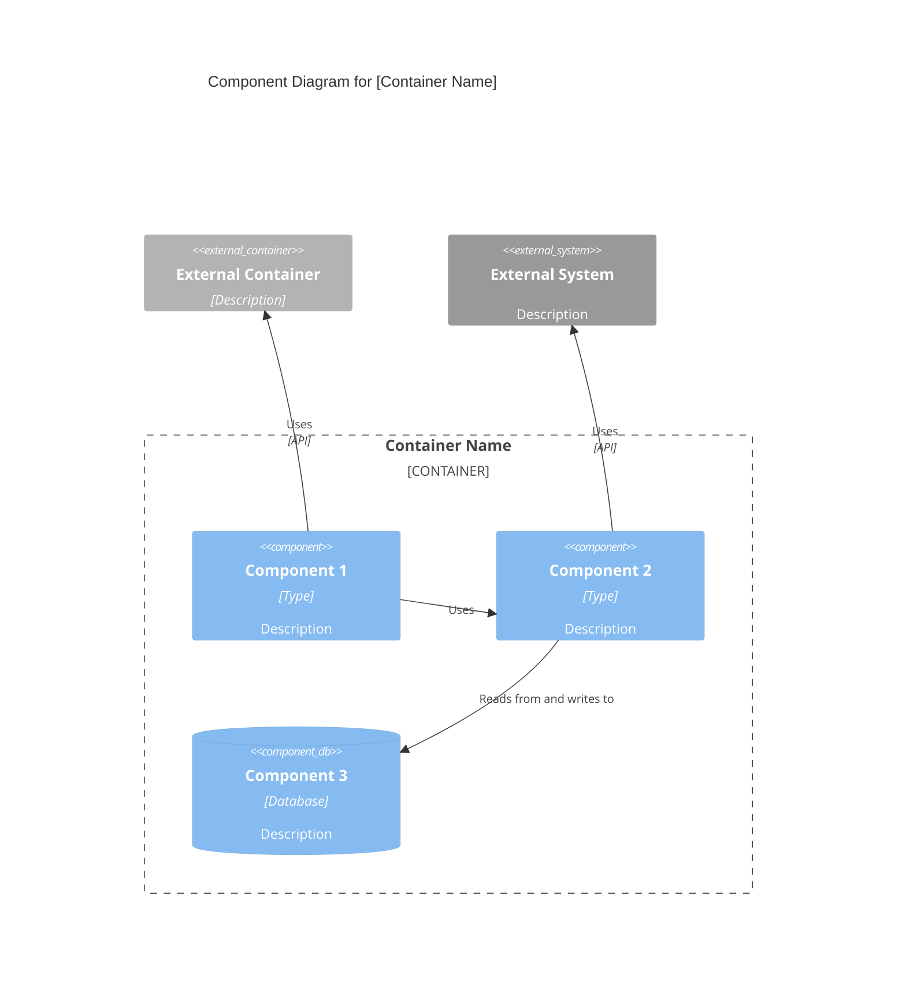

# C4 组件级：[组件名称]

## 何时使用此技能

- 处理 C4 组件级：[组件名称] 任务或工作流时
- 需要关于 C4 组件级：[组件名称] 的指导、最佳实践或检查清单时

## 何时不使用此技能

- 任务与 C4 组件级：[组件名称] 无关时
- 你需要不同的域或超出此范围的工具时

## 说明

- 澄清目标、约束和所需的输入。
- 应用相关的最佳实践并验证结果。
- 提供可操作的步骤和验证。
- 如果需要详细示例，打开 `resources/implementation-playbook.md`。

## 概述

- **名称**：[组件名称]
- **描述**：[组件目的的简短描述]
- **类型**：[组件类型：应用程序、服务、库等]
- **技术**：[使用的主要技术]

## 目的

[详细描述此组件的功能以及它解决的问题]

## 软件特性

- [特性 1]：[描述]
- [特性 2]：[描述]
- [特性 3]：[描述]

## 代码元素

此组件包含以下代码级元素：

- c4-code-file-1.md - [描述]
- c4-code-file-2.md - [描述]

## 接口

### [接口名称]

- **协议**：[REST/GraphQL/gRPC/事件等]
- **描述**：[此接口提供的内容]
- **操作**：
  - `operationName(params): ReturnType` - [描述]

## 依赖

### 使用的组件

- [组件名称]：[它是如何被使用的]

### 外部系统

- [外部系统]：[它是如何被使用的]

## 组件图

使用正确的 Mermaid C4Component 语法。组件图显示**单个容器内的**组件：


````

**关键原则**（来自 [c4model.com](https://c4model.com/diagrams/component)）：

- 显示**单个容器内的**组件（放大到一个容器）
- 重点关注**逻辑组件**及其职责
- 显示**组件接口**（它们公开的内容）
- 显示组件**如何相互作用**
- 包含**外部依赖**（其他容器、外部系统）

````

## 主要组件索引模板

```markdown
# C4 组件级：系统概览

## 系统组件

### [组件 1]
- **名称**：[组件名称]
- **描述**：[简短描述]
- **文档**：c4-component-name-1.md

### [组件 2]
- **名称**：[组件名称]
- **描述**：[简短描述]
- **文档**：c4-component-name-2.md

## 组件关系
[显示所有组件及其关系的 Mermaid 图表]
````

## 示例交互

- "将所有 c4-code-\*.md 文件合成为逻辑组件"
- "为身份验证和授权代码定义组件边界"
- "为 API 层创建组件级文档"
- "识别组件接口并创建组件图"
- "将数据库访问代码分组到组件中，并记录它们的关系"

## 关键区分

- **vs C4-Code agent**：将多个代码文件合成为组件；代码 agent 记录各个代码元素
- **vs C4-Container agent**：关注逻辑分组；容器 agent 将组件映射到部署单元
- **vs C4-Context agent**：提供组件级详情；上下文 agent 创建高级系统图

## 输出示例

合成组件时，提供：

- 清晰的组件边界及其原理
- 描述性的组件名称和目的
- 每个组件的全面特性列表
- 完整的接口文档（协议和操作）
- 所有包含的 c4-code-\*.md 文件的链接
- 显示关系的 Mermaid 组件图
- 带有所有组件的主要组件索引
- 跨所有组件的一致文档格式

## 限制
- 仅当任务明确与上述范围相符时，才使用此技能。
- 不要将输出视为环境特定验证、测试或专家审查的替代品。
- 如果缺少所需的输入、权限、安全边界或成功标准，请停止并要求澄清。
