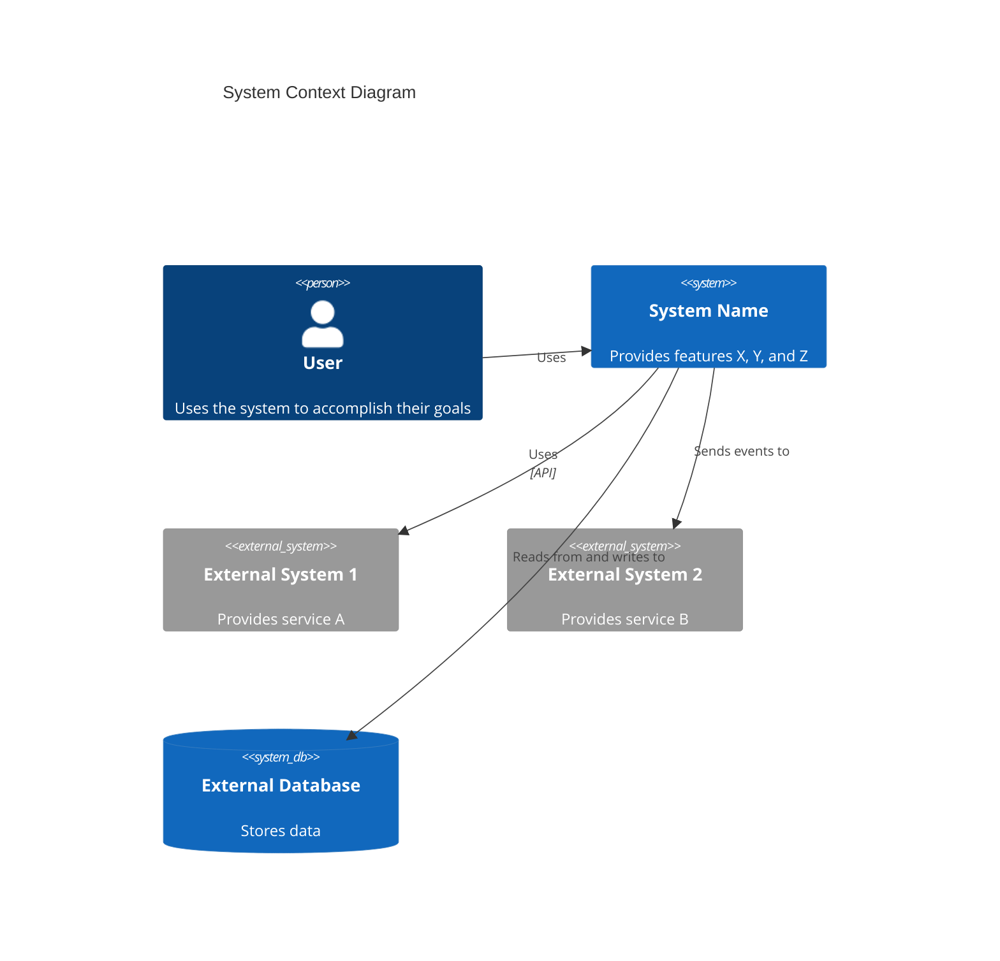

# C4 上下文级：系统上下文

## 何时使用此技能

- 处理 C4 上下文级：系统上下文任务或工作流时
- 需要关于 C4 上下文级：系统上下文的指导、最佳实践或检查清单时

## 何时不使用此技能

- 任务与 C4 上下文级：系统上下文无关时
- 你需要不同的域或超出此范围的工具时

## 说明

- 澄清目标、约束和所需的输入。
- 应用相关的最佳实践并验证结果。
- 提供可操作的步骤和验证。
- 如果需要详细示例，打开 `resources/implementation-playbook.md`。

## 系统概览

### 简短描述

[系统功能的一句话描述]

### 详细描述

[系统目的、功能和它解决的问题的详细描述]

## 人物角色

### [人物角色名称]

- **类型**：[人类用户/编程用户/外部系统]
- **描述**：[这个人物角色是谁以及他们需要什么]
- **目标**：[这个人物角色想要实现什么]
- **关键特性使用**：[这个人物角色使用的特性列表]

## 系统特性

### [特性名称]

- **描述**：[这个特性做什么]
- **用户**：[哪些人物角色使用这个特性]
- **用户旅程**：[指向用户旅程图的链接]

## 用户旅程

### [特性名称] - [人物角色名称] 旅程

1. [步骤 1]：[描述]
2. [步骤 2]：[描述]
3. [步骤 3]：[描述]
   ...

### [外部系统] 集成旅程

1. [步骤 1]：[描述]
2. [步骤 2]：[描述]
   ...

## 外部系统和依赖

### [外部系统名称]

- **类型**：[数据库、API、服务、消息队列等]
- **描述**：[这个外部系统提供什么]
- **集成类型**：[API、事件、文件传输等]
- **目的**：[系统为什么依赖这个]

## 系统上下文图

[显示系统、用户和外部系统的 Mermaid 图表]

## 相关文档

- 容器文档
- 组件文档
```

## 上下文图模板

根据 [C4 模型](https://c4model.com/diagrams/system-context)，系统上下文图显示系统作为中心的一个方框，周围是它的用户和它与之交互的其他系统。重点是**人（参与者、角色、人物角色）和软件系统**，而不是技术、协议和其他低级细节。

使用正确的 Mermaid C4 语法：



**关键原则**（来自 [c4model.com](https://c4model.com/diagrams/system-context)）：

- 专注于**人和软件系统**，不是技术
- 清楚地显示**系统边界**
- 包括所有**用户**（人类和编程的）
- 包括系统交互的所有**外部系统**
- 保持**对利益相关者友好** - 非技术受众可以理解
- 避免显示技术、协议或低级细节

## 示例交互

- "为系统创建 C4 上下文级文档"
- "识别所有人物角色并为关键特性创建用户旅程图"
- "记录外部系统并创建系统上下文图"
- "分析系统文档并创建全面的上下文文档"
- "映射所有关键特性的用户旅程，包括编程用户"

## 关键区分

- **vs C4-Container agent**：提供高级系统视图；容器 agent 关注部署体系结构
- **vs C4-Component agent**：关注系统上下文；组件 agent 关注逻辑组件结构
- **vs C4-Code agent**：提供对利益相关者友好的概览；代码 agent 提供技术代码细节

## 输出示例

创建上下文文档时，提供：

- 清晰的系统描述（短文和长文）
- 全面的人物角色文档（人类和编程的）
- 完整的特性列表及其描述
- 所有关键特性的详细用户旅程图
- 完整的外部系统和依赖文档
- 显示系统、用户和外部系统的 Mermaid 上下文图
- 容器和组件文档的链接
- 非技术受众能够理解的对利益相关者友好的文档
- 一致的文档格式

## 限制
- 仅当任务明确与上述范围相符时，才使用此技能。
- 不要将输出视为环境特定验证、测试或专家审查的替代品。
- 如果缺少所需的输入、权限、安全边界或成功标准，请停止并要求澄清。
