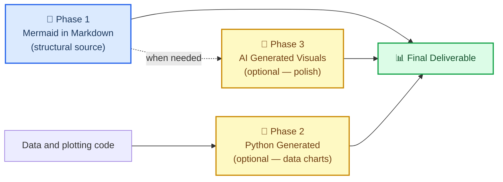
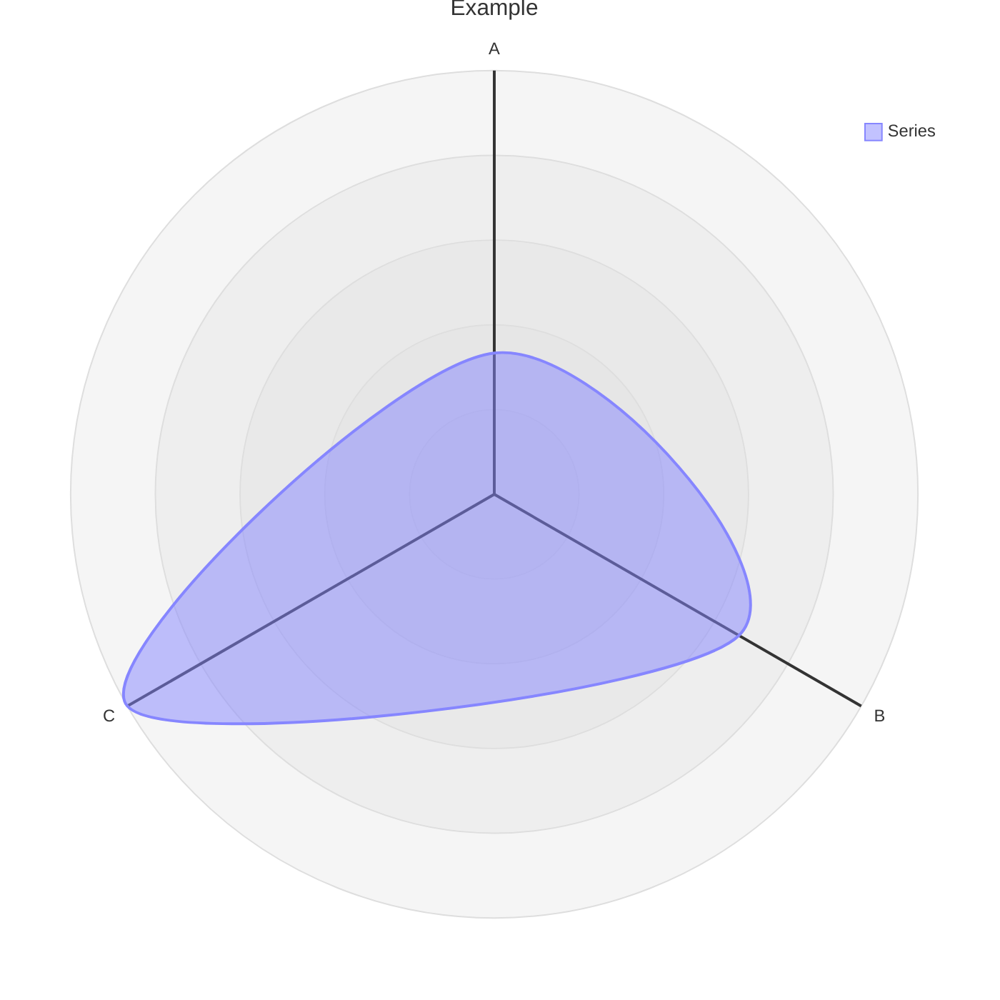

# Markdown 与 Mermaid 写作

## 概述

本技能为**带有 Mermaid 结构图的 Markdown 文档**提供了一套可选的内部风格。请首先遵循所要求的输出格式、现有仓库约定以及期刊要求。本技能不能替代科学分析或绘图。

在 `.md` 文件中以 Mermaid 表达的关系是可编辑的文本,在 git 中能够干净地做 diff。兼容的宿主无需用户单独构建即可渲染它。
它仅在宿主支持 Mermaid 的地方才会渲染;普通 Markdown 查看器可能只显示代码,不同平台/扩展所搭载的 Mermaid 版本也不同。它使用
一种紧凑的源码表示形式,不过具体的 token 用量取决于图表本身。导出
SVG/PNG 需要渲染器;请将图表源码与导出的图形一起保留。

> “把你的报告和文件尽量以 .md 这种普通文本形式保存,mermaid 既是这样的文本,也是一种简单的‘脚本语言’。这对任何下游渲染都有帮助,尤其是对 AI 生成的图像(用 mermaid 来描述关系,而不是用冗长的文字描述,能省下更多 token)。此外 mermaid 几乎可以在任何地方与 markdown 一起渲染,方便人类或 AI 使用。”
>
> —— Clayton Young(@borealBytes),K-Dense Discord,2026-02-19

## 何时使用本技能

在以下情况下使用本技能:

- 撰写所要求的 Markdown 报告、README、方法概述或研究笔记
- 为工作流程、数据管道、模式(schema)、状态机或概念关系绘图
- 维护可编辑的 Mermaid 源码及其渲染后的 SVG/PNG 导出文件

对于测量数据、不确定性、统计图形、精确几何,或 Mermaid 无法忠实表达的出版级图形,请直接使用科学绘图工具。Mermaid
不是定量图表或已有的 SVG/代码原生资产的必经前置步骤。

## 🎨 源码格式理念

### 为什么基于文本的图表更胜一筹

| 关键点 | Markdown 中的 Mermaid | Python / AI 图像 |
| ----------------------------- | :-----------------: | :---------------: |
| Git diff 可读 | ✅ 文本源码 | 绘图代码/SVG 也可以是文本 |
| 可编辑源码 | ✅ | 绘图脚本和矢量源码也可编辑 |
| 紧凑的关系表示法 | 通常是 | 取决于表示方式 |
| 原生预览 | 取决于宿主/版本 | 取决于查看器/格式 |
| AI 无需视觉即可解析 | ✅ | ❌ |
| 在目标环境中生效 | 需检查 Mermaid 支持和版本 | 需检查图像格式支持 |
| 无障碍(屏幕阅读器) | 需检查 SVG 元数据和文本替代 | 需提供替代文本/数据表 |
| 可随时转换为图像 | ✅ 任何时候 | —— 本身已是图像 |

### 三阶段工作流程



结构图保留使用 Mermaid,定量图表使用数据和代码。AI 生成的插图
不是定量转换;请对照数据来源核实每一个标签和关系。

### Mermaid 能表达什么

本技能包含 23 种图表类型指南,外加一份组合指南。Mermaid 支持
更多类型;这些参考资料是经过筛选的子集,不是详尽的版本目录:

| 使用场景 | 图表类型 | 文件 |
| -------------------------------------------- | ---------------- | ---------------------------------------------------- |
| 实验工作流程/决策逻辑 | 流程图 | `references/diagrams/flowchart.md` |
| 服务交互/API 调用/消息传递 | 序列图 | `references/diagrams/sequence.md` |
| 数据模型/模式 | ER 图 | `references/diagrams/er.md` |
| 状态机/生命周期 | 状态图 | `references/diagrams/state.md` |
| 项目时间线/路线图 | 甘特图 | `references/diagrams/gantt.md` |
| 比例/组成 | 饼图 | `references/diagrams/pie.md` |
| 系统架构(不同缩放层级) | C4 图 | `references/diagrams/c4.md` |
| 概念层级/头脑风暴 | 思维导图 | `references/diagrams/mindmap.md` |
| 时间顺序事件/历史 | 时间线图 | `references/diagrams/timeline.md` |
| 类层级/类型关系 | 类图 | `references/diagrams/class.md` |
| 用户旅程/满意度地图 | 用户旅程图 | `references/diagrams/user_journey.md` |
| 双轴比较/优先级排序 | 四象限图 | `references/diagrams/quadrant.md` |
| 需求可追溯性 | 需求图 | `references/diagrams/requirement.md` |
| 流量大小/资源分布 | 桑基图 | `references/diagrams/sankey.md` |
| 数值趋势/柱状图+折线图 | XY 图 | `references/diagrams/xy_chart.md` |
| 组件布局/空间排列 | 块图 | `references/diagrams/block.md` |
| 工作项状态/任务列 | 看板 | `references/diagrams/kanban.md` |
| 云基础设施/服务拓扑 | 架构图 | `references/diagrams/architecture.md` |
| 多维比较/技能雷达 | 雷达图 | `references/diagrams/radar.md` |
| 层级比例/预算 | 矩形树图 | `references/diagrams/treemap.md` |
| 二进制协议/数据格式 | 数据包图 | `references/diagrams/packet.md` |
| Git 分支/合并策略 | Git 图 | `references/diagrams/git_graph.md` |
| 代码风格序列图(编程语法) | ZenUML | `references/diagrams/zenuml.md` |
| 多图组合模式 | 复杂示例 | `references/diagrams/complex_examples.md` |

> 💡 **选择正确的类型,而不是最省事的类型。** 不要什么都默认用流程图。
> 对于按时间顺序发生的事件,时间线图比流程图更合适。对于服务交互,
> 序列图比流程图更合适。浏览上表并进行匹配。

---

## 🔧 核心工作流程

### 第一步:确定文档类型

在从零开始写之前先检查是否已有可用模板:

| 文档类型 | 模板 |
| ------------------------------ | ----------------------------------------------- |
| 拉取请求记录 | `templates/pull_request.md` |
| 问题/缺陷/功能请求 | `templates/issue.md` |
| 迭代/项目看板 | `templates/kanban.md` |
| 架构决策记录(ADR) | `templates/decision_record.md` |
| 演示文稿/简报 | `templates/presentation.md` |
| 研究论文/分析 | `templates/research_paper.md` |
| 项目文档 | `templates/project_documentation.md` |
| 操作指南/教程 | `templates/how_to_guide.md` |
| 状态报告 | `templates/status_report.md` |

### 第二步:阅读风格指南

对于这个 Markdown 工作流程,请阅读 `references/markdown_style_guide.md`。请将表情符号、
标题数量和水平分割线视为内部风格,而不是 Markdown 语法要求。

需要内化的关键规则:

- **每份文档只有一个 H1** —— 即标题。绝不能有多个。
- **仅在 H2 标题上使用表情符号** —— 每个 H2 一个表情符号,H3/H4 中不使用
- **为事实性论断提供支撑** —— 使用经过核实的来源和所要求的引用格式
- **粗体要慎用** —— 每段最多 2–3 个粗体词,绝不对整句使用粗体
- 在 `</details>` 之后**可选地**使用水平分割线,如果它能改善分隔效果
- 对于比较、配置、结构化数据,**优先使用表格而不是大段文字**
- **用图表代替大段文字** —— 如果内容描述的是流程、结构或关系,就加入 Mermaid 图

### 第三步:选择图表类型并阅读对应指南

在创建任何 Mermaid 图之前:先阅读 `references/mermaid_style_guide.md`。

然后打开具体类型对应的文件(例如 `references/diagrams/flowchart.md`),获取示例、特定技巧和可直接复制使用的模板。

对于所选渲染器支持输出的类型,添加无障碍元数据:

```
accTitle: Short Name 3-8 Words
accDescr: One or two sentences explaining what this diagram shows.
```

- 优先使用宿主主题;`%%{init}` 指令已被弃用,取而代之的是 YAML 配置
- 在受支持的地方优先使用可复用的 `classDef`;样式语法因图表类型而异
- **每个节点最多一个表情符号** —— 放在标签开头
- 使用符合该类型语法的描述性 ID:`snake_case` 适用于流程图;ER 图/类图/状态图的惯例各不相同

### 第四步:撰写文档

从模板开始。应用 Markdown 风格指南。将图表与相关文本放在一起 —— 而不是放在单独的“图表”章节中。

在交付之前,先在**实际的目标环境**中进行渲染。在选择较新的图表类型之前,先检查该环境的 Mermaid
版本和插件要求;[GitHub 为此提供了一个用于检测的 `info`
图](https://docs.github.com/en/get-started/writing-on-github/working-with-advanced-formatting/creating-diagrams)。
在最新版本下本地预览成功,并不能证明 GitHub 或其他宿主
也能正确渲染它。在不支持 Mermaid 的地方,应提供带文字说明的渲染后 SVG/PNG,
同时保留 `.md` 源码。

### 第五步:保留源码与验证记录

将 `.md` 源码、渲染后的交付物以及经过测试的渲染器版本一起保存。
请遵循项目自身的版本控制工作流程;本技能本身并不授权提交或发布。
关于 CLI 导出、嵌入方式以及经过测试的无障碍矩阵,请阅读
[当前渲染与验证](references/current-rendering.md)。

---

## ⚠️ 常见陷阱

### 雷达图语法(`radar-beta`)

**错误写法(以纯文本形式展示,以免破坏本文档的渲染器):**
```text
radar
title Example
x-axis ["A", "B", "C"]
"Series" : [1, 2, 3]
```

**正确写法:**


- **使用 `radar-beta`**,而不是 `radar`(单独的 `radar` 关键字并不存在)
- **使用 `axis`** 来定义维度,**不要**使用 `x-axis`
- **使用 `curve`** 来定义数据系列,**不要**使用带冒号的带引号标签
- Mermaid 12.0.0 的雷达图会输出 `accTitle`/`accDescr`;请检查较旧的宿主环境,并保留一段可见的文字说明

### XY 图与雷达图的混淆

| 图表 | 关键字 | 坐标轴语法 | 数据语法 |
| ------- | ------- | ----------- | ----------- |
| **XY 图**(柱状图/折线图) | `xychart-beta` | `x-axis ["Label1", "Label2"]` | `bar [10, 20]` 或 `line [10, 20]` |
| **雷达图**(蜘蛛图/网状图) | `radar-beta` | `axis id["Label"]` | `curve id["Label"]{10, 20}` |

### 忘记在受支持的类型上添加 `accTitle`/`accDescr`

只有部分图表类型支持 `accTitle`/`accDescr`。对于不支持的类型,请始终在代码块正上方放置一段描述性的斜体文字:

> _雷达图在一个明确标注的、共用的评分量表上比较三种方法。确切数值请参见数据表。_

```text
radar-beta
...
```

---

## 🔗 与其他技能的整合

### 与 `scientific-schematics` 的整合

`scientific-schematics` 可生成由 AI 驱动的出版级质量图像(PNG)。将 Mermaid 图用作该示意图的**需求说明**:

```
工作流程:
1. 以 Mermaid 的形式在 .md 中创建该概念(本技能 —— 第一阶段)
2. 将同一概念描述给 scientific-schematics,以生成精美的 PNG(第三阶段)
3. 两者一并提交 —— .md 作为源码,PNG 作为补充图
```

### 与 `scientific-writing` 的整合

对于使用 Mermaid 结构图的手稿,本技能负责图表语法。
请遵循手稿所要求的图表格式和科学可视化惯例。

```
工作流程:
1. 使用 scientific-writing 起草手稿
2. 对于每一个展示工作流程、架构或关系的图:
   - 将占位图替换为按本技能指南绘制的 Mermaid 图
3. 在适合科学内容的地方使用绘图或示意图工具
```

### 与 `literature-review` 的整合

文献综述会生成带有大量关系数据的摘要。可用本技能来:

- 绘制文献领域的概念图(思维导图)
- 展示出版物时间线(时间线图或甘特图)
- 比较方法学(四象限图或雷达图)
- 为论文中描述的数据流绘图(序列图或流程图)

### 与任何生成输出文档的技能的整合

在使用本技能最终完成一份文档之前,请检查:

- [ ] 该文档是否使用了模板?如果是,是否从正确的模板开始的?
- [ ] 每个图表是否使用了恰当的格式,并带有有效的无障碍元数据或文字替代内容?
- [ ] 目标环境是否支持该配置,并且是否在浅色/深色主题下都测试过?
- [ ] 引用是否支撑了外部论断,合成数值是否已标注?
- [ ] 是否只有一个 H1,表情符号是否仅出现在 H2?
- [ ] 最终的 Markdown/HTML 结构是否能正确渲染?

---

## 📚 参考索引

### 风格指南

| 指南 | 路径 | 行数 | 涵盖内容 |
| ----------------------- | ------------------------------------------- | ----- | -------------------------------------------------- |
| Markdown 风格指南 | `references/markdown_style_guide.md` | 见文件 | 标题、格式、引用、表格、Mermaid 整合、模板、质量检查清单 |
| Mermaid 风格指南 | `references/mermaid_style_guide.md` | 见文件 | 无障碍、表情符号集合、颜色类、主题中立性、类型选择、复杂度分级 |
| 当前渲染情况 | `references/current-rendering.md` | 见文件 | Mermaid 12 的变化、CLI 导出、浏览器 API、经过测试的无障碍矩阵、科学性检查 |

### 图表指南(23 种类型外加组合指南)

每个文件均包含:生产级质量的示例、该类型特有的技巧,以及可直接复制使用的模板。

`references/diagrams/` —— architecture、block、c4、class、complex\_examples、er、flowchart、gantt、git\_graph、kanban、mindmap、packet、pie、quadrant、radar、requirement、sankey、sequence、state、timeline、treemap、user\_journey、xy\_chart、zenuml

### 文档模板(9 种类型)

`templates/` —— decision\_record、how\_to\_guide、issue、kanban、presentation、project\_documentation、pull\_request、research\_paper、status\_report

### 示例

`assets/examples/example-research-report.md` —— 一份合成的质量控制报告,其中数据明确标注为虚构,包含一个可审计的计数表、一个结构性流程图、一个柱状图和一份年表。该文件不涉及任何实验或软件 API 方面的论断。

---

## 📝 署名

本技能中的所有风格指南、图表类型指南和文档模板均在 Apache-2.0 许可下,从 `SuperiorByteWorks-LLC/agent-project` 仓库移植而来。

- **来源**: https://github.com/SuperiorByteWorks-LLC/agent-project
- **作者**: Clayton Young / Superior Byte Works, LLC (@borealBytes)
- **许可证**: Apache-2.0

本技能(作为 scientific-agent-skills 的一部分)以 MIT 许可证分发。所包含的 Apache-2.0 内容在保留署名的前提下兼容下游使用,这一署名已保留在本技能各文件的文件头中。

---

[^1]: GitHub Blog. (2022). "Include diagrams in your Markdown files with Mermaid." https://github.blog/2022-02-14-include-diagrams-markdown-files-mermaid/

[^2]: Mermaid. "Mermaid Diagramming and Charting Tool." https://mermaid.js.org/
